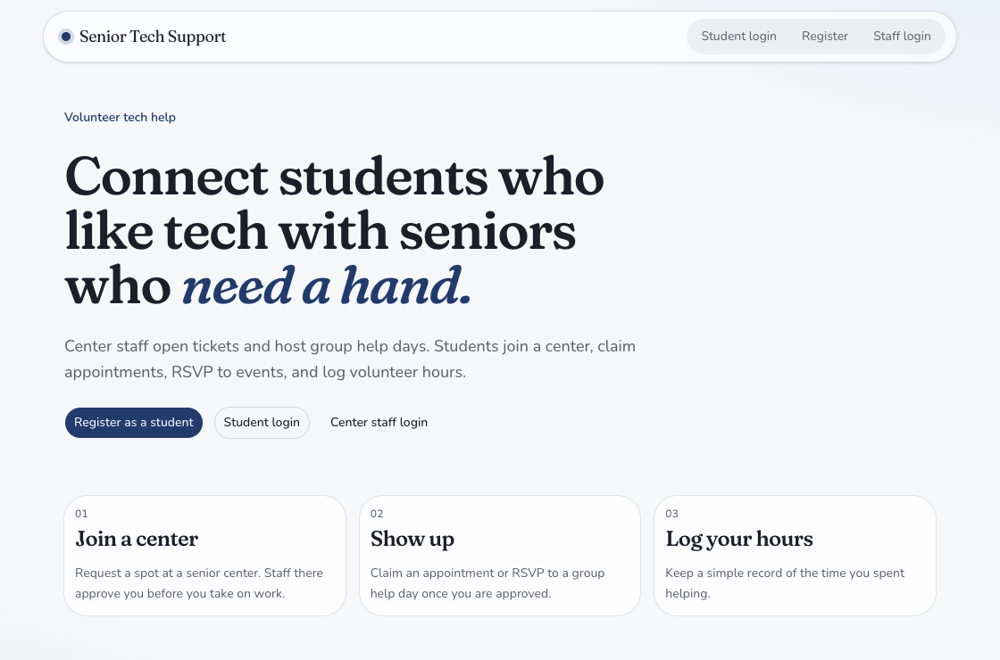
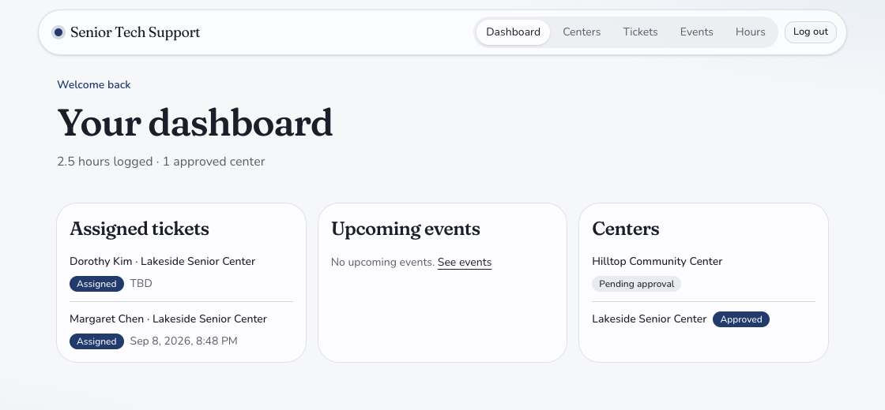
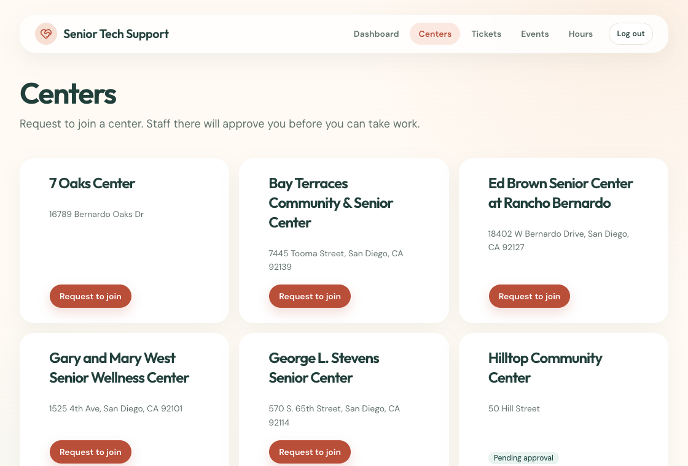
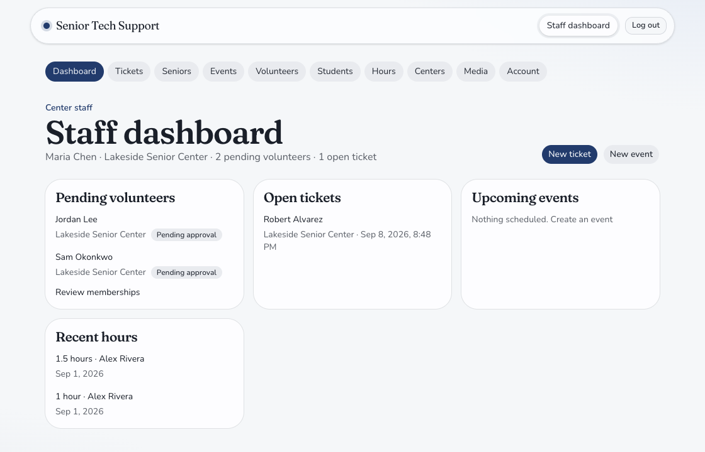
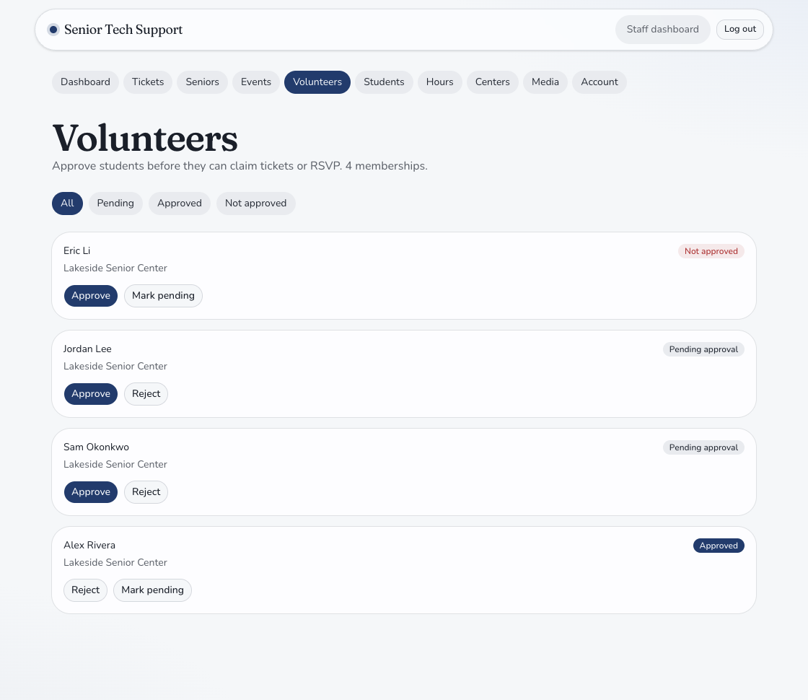

# Senior Tech Support

I built this project for the 2026 Congressional App Challenge in Representative Scott Peters's district. I am also working on a national instance. This repository shares the source code so students elsewhere can launch their own instance for the senior centers in their area.


**A simple way for community centers to organize tech help from student volunteers.**

Center staff keep a record of the seniors they serve, post individual support tickets, and schedule group help days. Students request to join a center, take on work after approval, and log their volunteer hours. The app gives each group a focused view of the same program. The home page features a photo gallery of community tech help moments.

Each deployment has its own database and center records. To run this for your community, follow [DEPLOY.md](DEPLOY.md). The included San Diego records and accounts are for local development; production starts without them.



## How it works

1. **Join a center.** A student creates an account and requests membership at a senior center.
2. **Get approved.** Staff review the request before the student can take work at that center.
3. **Help a senior.** An approved student claims an open ticket or RSVPs to a group event.
4. **Keep a record.** Ticket notes capture progress, while hour logs record the time volunteered.

## Screenshots

### Student dashboard

Students see their assigned tickets, upcoming events, center memberships, and total logged hours.



### Find a center

Students can browse participating centers and request to join a volunteer team.



### Staff dashboard

Center staff can review pending volunteers, open tickets, upcoming events, and recent hours.



### Volunteer approvals

Staff decide which students can volunteer at their center.



_Application screenshots show local demo data. The home page gallery uses photos from the project._

## What is included

- **Student experience:** registration, center requests, ticket claiming, event RSVPs, ticket notes, and hour logs.
- **Staff experience:** senior profiles and visit history, volunteer approvals, tickets, group events, student records, and hours.
- **Access control:** students work only at approved centers; center staff manage their assigned center; super admins manage the whole program, including centers and staff accounts.
- **Admin tools:** a custom staff interface at `/staff` and a Payload admin panel at `/admin`.

## Run locally

You need **pnpm** and **MongoDB**; **Node.js 22** is recommended. Docker can run MongoDB if you do not have a local instance.

1. Install dependencies and create a local environment file:

   ```bash
   pnpm install
   cp .env.example .env
   ```

2. Set `DATABASE_URL` in `.env` to your MongoDB database and replace `PAYLOAD_SECRET` with a long random value. For the included Docker Compose MongoDB service, use:

   ```dotenv
   DATABASE_URL=mongodb://127.0.0.1:27017/senior-tech-support
   PAYLOAD_SECRET=replace-with-a-long-random-secret
   ```

3. Start MongoDB, then the app:

   ```bash
   docker compose up -d mongo
   pnpm dev
   ```

4. Open [http://localhost:3000](http://localhost:3000).

In development, the app seeds sample centers, users, tickets, events, and hour logs when Payload initializes. The seed checks for existing demo records so a normal restart does not recreate them. Production does not run the demo seed.

<details>
<summary>Local demo accounts</summary>

All three seeded accounts use the password `changeme`:

- Student: `alex@student.edu`
- Center staff: `maria@lakeside.org`
- Super admin: `admin@example.com`

These credentials are for local demos only. A fresh production database does not include these accounts; use a strong `PAYLOAD_SECRET` and create your own administrator.

</details>

## Bring it to your area

Start with a fresh database, create your own administrator, and add your local centers and staff. Students can then register and request to join a center. Update the site name, gallery photos, and any local wording before sharing your instance. [DEPLOY.md](DEPLOY.md) gives students and coding agents the deployment steps and a launch checklist.

## Project structure

```text
src/
├── app/(frontend)/       Student and staff pages, forms, and server actions
├── app/(payload)/        Payload admin and API routes
├── assets/gallery/       Home page community photos
├── collections/          Program data models and collection permissions
├── access/               Role and center access rules
├── hooks/                Data validation and workflow rules
└── seed/                 Local demo data
```

The app uses **Next.js**, **React**, **TypeScript**, **Payload CMS**, **MongoDB**, and **Tailwind CSS**. Payload access rules and hooks enforce membership approval, center scope, ticket assignment, RSVP limits, and valid hour-log links.

## Development commands

```bash
pnpm dev          # Start the local app
pnpm build        # Build for production
pnpm lint         # Run ESLint
pnpm test:int     # Run integration tests
pnpm test:e2e     # Run browser tests
```

The browser tests use Playwright and expect MongoDB and the demo seed. If Chromium is missing, install it with `pnpm exec playwright install chromium`.
